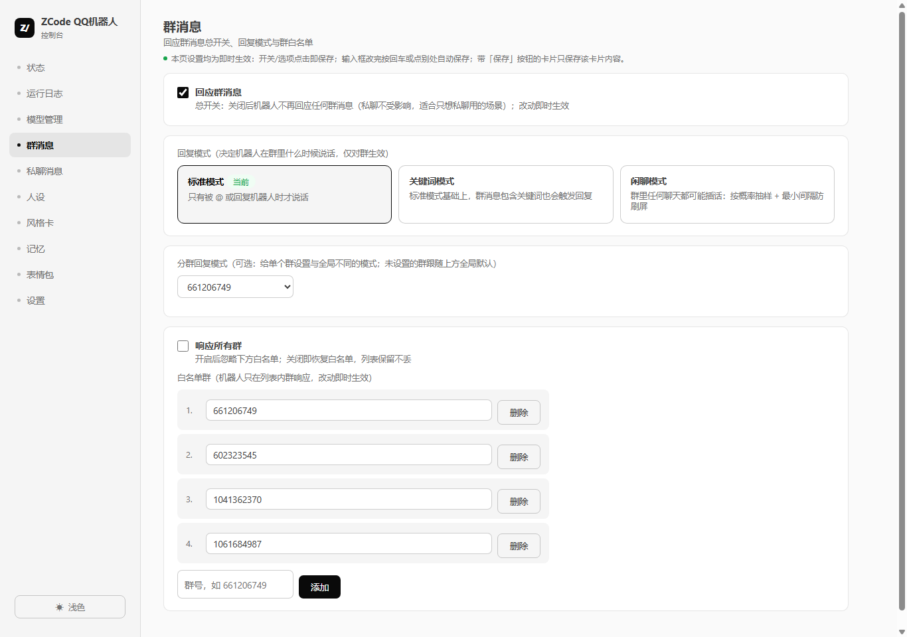

# ZCode QQ机器人

<p align="center">
  <a href="README.md">简体中文</a> · <a href="README_EN.md">English</a>
</p>

一个跑在 Windows 电脑上的 QQ 群聊 AI 机器人，智谱 GLM 驱动，桌面应用形态，也能作为 ZCode 插件安装。

它跟常见的"接 API 就能跑"的 QQ 机器人不太一样，差别主要在这几处：

- **不只是聊天**。看图、生图、联网搜索、发语音、操作电脑、跑脚本任务都是内置能力，不是外挂的脚本拼盘。设备操控走动态授权码，用一次换一次。
- **真的有记性**。聊天里随口提到的事会沉淀成长期记忆，下次聊天她自己会带出来；说话风格也会从群聊里持续提炼，越用越贴合。
- **插件管功能扩展**。语音回复、B站刷视频、聊天记录导入这些全是市场插件——装不装、什么时候更新，都跟主程序无关。你自己也能写插件上架，不用等我发版。
- **所有数据留在本机**。人设、记忆、API Key、聊天记录全在 `~/.zcode-qq-bot/`，没有云服务，没有账号体系，拷走文件夹就是完整迁移。

消息收发走 [NapCat](https://napcat.net)（QQNT 协议实现）。所有行为由本机管理台控制。



## 目录

- [功能](#功能)
- [插件市场](#插件市场)
- [架构](#架构)
- [安装](#安装)
- [日常使用](#日常使用)
- [运维](#运维)
- [安全与风险](#安全与风险)
- [常见问题](#常见问题)
- [参与贡献](#参与贡献)

---

## 功能

### 聊天

多人设是她比较特别的地方：可以建好几张人设卡随时切换，还能按对象分——比如某个朋友的私聊用 A 人设，某个群用 B 人设，没单独设置的人走全局默认。切人设是即时的，不用重启。

说话风格会自己长。机器人会定期从群聊里提炼"最近大家说话什么味儿"，归纳成一两条观察写进对应人设，所以聊得越久她越像"你们群的人"而不是一直用出厂设置。

记忆分两类：关于某个具体人的（"他上周说要去面试"）和群事件的（"我们约好周五开黑"），都会自动记，也能在管理台手动改。回复时会带上这些记忆，但她不会每次都翻旧账——只在话题相关的时候提。

回复模式有三种：标准（只有@和回复她才说话）、关键词、闲聊（按概率插话，插之前会判断"这话值不值得接"和"是不是在跟别人说话"）。每个群可以单独设不同模式。群里如果混进了别的 AI 机器人跟她高频互聊，她会像真人一样问一句"你是不是AI"，确认后就自然收尾不再陪聊。

表情包库分三层：人设专属的、大家通用的、从QQ收藏导入的。发之前视觉模型会先看懂这张图是什么，再判断跟当前对话搭不搭——所以她很少发错表情。发起来也有频率限制，不会连着刷屏。

### 能力

**看图**：消息里的图片直接丢给视觉模型，截图、表情包、照片都看得懂。可以给视觉单独配一个模型，不用主对话模型兼着。

**生图**：说"画一张xxx"或者更自然的"帮我画个头像呗"都行。没有必须以什么格式开头的死规定——有时候模型听懂了但系统没接住，她自己会补一个内部标记再触发一次。

**联网搜索**：问实时性问题（新闻、版本更新、价格）会自动搜。优先走智谱的搜索资源包，没开通就自动切必应的免费接口，不用额外花钱。日常闲聊不会触发搜索，不产生费用。

**语音**：装上语音回复插件后她能发语音消息。声音来源有四种——Edge-TTS 完全免费还内置九个中文音色；智谱 GLM-TTS 收费但支持拿三秒录音克隆专属音色；还有硅基流动和任意 OpenAI 兼容服务。什么时候发语音你可以定规则：设触发词、全用语音、或者触发词必语音其余按概率。合成失败会自动改发文字，不会丢消息。

**任务沙箱**：发"任务：写个爬虫抓xxx"，会转给一个独立沙盒进程去写代码跑脚本，有白名单命令和时长限制，结果自动发回来。

**设备操控**：这是最能打也最危险的功能。主人私聊说"帮我在电脑上找一下那份报告"，她会先要一个 6 位动态授权码（控制台上实时显示，用一次换一次），授权后就能像聊天一样指挥——找文件、读文件、发文件、开关程序。系统关键进程碰不了，保护目录进不去，所有结果只发私聊。不用的时候关掉即可。

**主动消息**：可以让她自己找话题搭话，群和私聊分开控制，有概率、频率上限、禁用时段。凌晨三点她不会来吵你，除非你让她吵。

**定时任务**："定时 22:00 写周报"，到点自动跑，跑完发结果。

**B站刷视频**（插件）：她用自己注册的B站账号按人设兴趣刷视频。看过的会变成谈资自然出现在聊天里；真心觉得好的会主动分享给你——B站私信或QQ都行，每个渠道每轮最多发几条也能单独设。聊天里出现BV号她会自动带上视频信息。

**聊天记录导入**（插件，QQ/微信两个版本）：想把某段聊天记录喂给她学？最简单的方式是把记录合并转发给她再句"导入"——直接进隔离库，插件页点"学习成人设"让她消化成草稿。也支持文件导入和工具一键导出。

**飞书互通**（插件）：QQ群和飞书群双向桥接，不用公网服务器。

### 架构

```
qq_app.py         桌面外壳（pywebview 窗口 + 托盘 + 单实例锁 + 窗口自愈）
  ├─ qq_admin_ui.py    管理台 :39765（页面 + 全部配置 API，仅监听 127.0.0.1，访问令牌鉴权）
  ├─ qq_daemon.py      消息管道 :39763（OneBot WS 客户端、触发判定、发送队列、活性探活）
  ├─ qq_bot_agent.py   自治大脑 :39764（模型链降级、人设/记忆/安全、设备操控、主动消息、复盘）
  ├─ qq_tts.py         语音合成引擎（Edge/智谱/硅基流动/自定义 OpenAI 兼容）
  ├─ qq_chatimport.py  聊天记录导入引擎（解析/隔离库/学习）
  ├─ qq_lark.py        飞书互通引擎
  ├─ qq_plugins.py     插件宿主（钩子路由/热重载/私有存储/自定义端点）
  ├─ qq_task_worker.py 任务沙盒子进程
  └─ qq_mcp_server.py  ZCode 插件 MCP 服务器（stdio，随插件启动）
qq_services.py    组件生命周期（幂等启停、NapCat 配置生成、zip 安装器、开机自启）
qq_common.py      路径/配置/供应商注册表/时区（数据目录默认 ~/.zcode-qq-bot，QQBOT_DATA_DIR 可覆盖）
```

## 安装

### 发布版（推荐）

1. 从 [Releases](../../releases) 下载 zip 解压
2. 双击 `ZCodeQQBot/ZCodeQQBot.exe`
3. 首启向导里填机器人 QQ 号和你的 QQ 号
4. 设置页填一个智谱 API Key（[open.bigmodel.cn](https://open.bigmodel.cn) 注册就有免费额度）
5. 状态页点"启动机器人"，弹出的 NapCat 页面用机器人 QQ 扫码

登录页如果要填"登录密钥"不用慌：状态页有张卡片自动显示密钥，一键复制就行；或者直接点"打开登录页（免密钥）"跳过。

### 源码运行

```
git clone https://github.com/Pigeon2333/zcode-qq-bot.git
pip install pywebview pystray pillow edge-tts
cd plugins/qq-bot/scripts
python qq_app.py
```

### 前置要求

Windows 10/11 x64；电脑上装着 QQNT 版 QQ；NapCat Shell（管理台能一键装）；一个智谱 API Key。

## 日常使用

主人私聊发"帮助"能看到全部指令。常用就这几个：画图直接说；设备操控先表达意图再给授权码；定时任务格式是"定时 22:00 干什么"；让机器人安静一会儿说"安静"；合并转发聊天记录加句"导入"就能喂她学。

群成员那边能体验到的：@她聊天、发图给她看、被她记住偏好、（你开了的话）她的主动搭话、装了插件的话还有签到和视频分享。让人代写作业会被用人设口吻回绝——她不是工具人。

## 运维

日志在 `~/.zcode-qq-bot/logs/`，管理台运行日志页四源聚合实时看，能一键导出诊断包发给别人帮忙看。

几个常见征象的判断：

- 机器人显示在线但完全不回消息——大概率 NapCat 推送半死，看门狗会自动恢复，等不住就全部停止再启动
- 日志里 AGENT_MODEL_FAIL 连片——看后面的错误码，429 是过载（链会自动切）、1308 是智谱5小时窗口、1314 是套餐失效（换Key或删那条）
- 人设改坏了或者丢了——设置页从备份恢复，选个早上的快照

升级走应用内更新（关于页），全程不动数据目录。插件更新独立于应用版本，市场里点更新就行。

## 安全与风险

管理台只监听 127.0.0.1，所有 API 走访问令牌鉴权。设备操控是三层保护：仅主人QQ、动态授权码用一次换一次、系统关键进程和保护目录碰不了。

但有几件事你得自己心里有数：

- **设备操控是真的在操作你的电脑**。别在公用机器上开这个功能，保护目录按需加，不用的时候关掉。
- **API Key 明文存在本机**。这是桌面应用的常态，但意味着谁拿到你电脑上的 `~/.zcode-qq-bot/` 谁就能用你的额度。别把它提交到仓库，别放网盘同步目录。
- **NapCat 是非官方协议实现**，理论上有触发腾讯风控的可能。自己权衡，建议用小号。
- **她说的每句话都是 AI 生成的**。安全规则加了不少但不保证万无一失，群聊场景自己留心。

## 常见问题

**机器人显示在线但不回消息？**
八成是 NapCat 推送半死。看门狗默认开着会自己恢复，急用就全部停止再启动。

**启动时说 agent 启动失败？**
九成是还没填 API Key。填了立即生效，不用重启。

**NapCat 登录页要填"登录密钥"哪里拿？**
状态页的密钥卡片，一键复制。扫码登录成功后 NapCat 会换一次密钥，到时候回卡片点刷新。

**QQ 自带的聊天记录导出（.bak 文件）能导入吗？**
不能。那个文件是账号加密的，第三方拿不到密钥。用合并转发给她 + 说"导入"，或者按插件页引导导出成文本再导入。

**换电脑怎么迁移？**
把 `~/.zcode-qq-bot/` 整个文件夹拷过去（里面有密钥，注意保管）。

**不想让机器人在某个群说话？**
群消息页把那个群设成"暂停回应"，或者从白名单删掉（会弹确认）。

## 参与贡献

Issue 提 bug 和想法都欢迎。PR 方向：更多供应商适配、表情包源、插件生态、UI、测试、文档。想写插件的话看 [PLUGINS.md](./PLUGINS.md)，写完可以提 Issue 申请上架市场。

一个约定：改人设相关的文案只进人设卡，别动底层提示词——那是所有人的底线，也是插件能力归属清晰的前提。

## 作者

从不咕咕的鸽纸 · [B站](https://space.bilibili.com/280664902) · [GitHub](https://github.com/Pigeon2333) · ed@sodayo.net

大脑是[智谱 GLM](https://open.bigmodel.cn)，协议层是 [NapCat](https://napcat.net)，联动生态是 [ZCode](https://zcode.ai)。谢谢测试群里陪她聊天、帮她变得越来越像真人的朋友们。

## 许可证

[PolyForm Noncommercial 1.0.0](./LICENSE)：个人学习、研究、修改、分发都可以；商业用途不行。分发时保留许可证声明。
