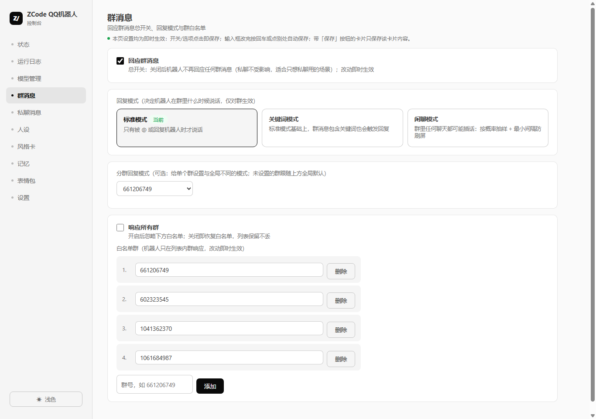
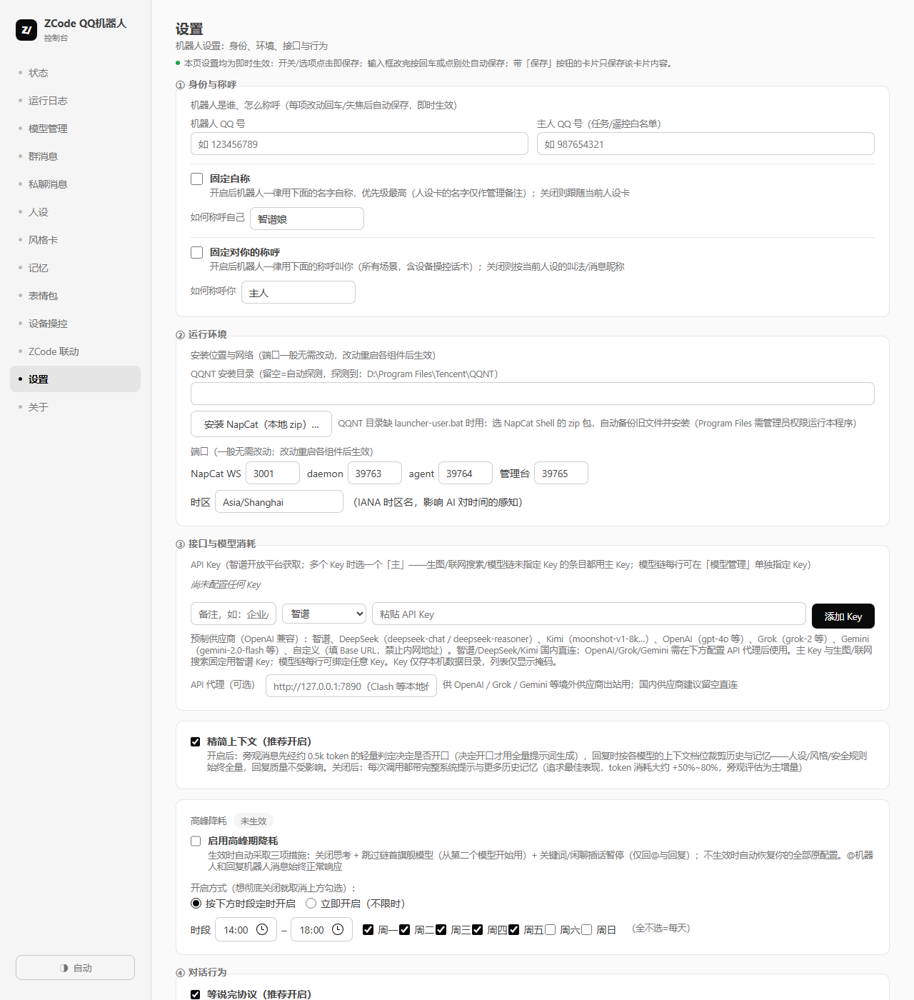
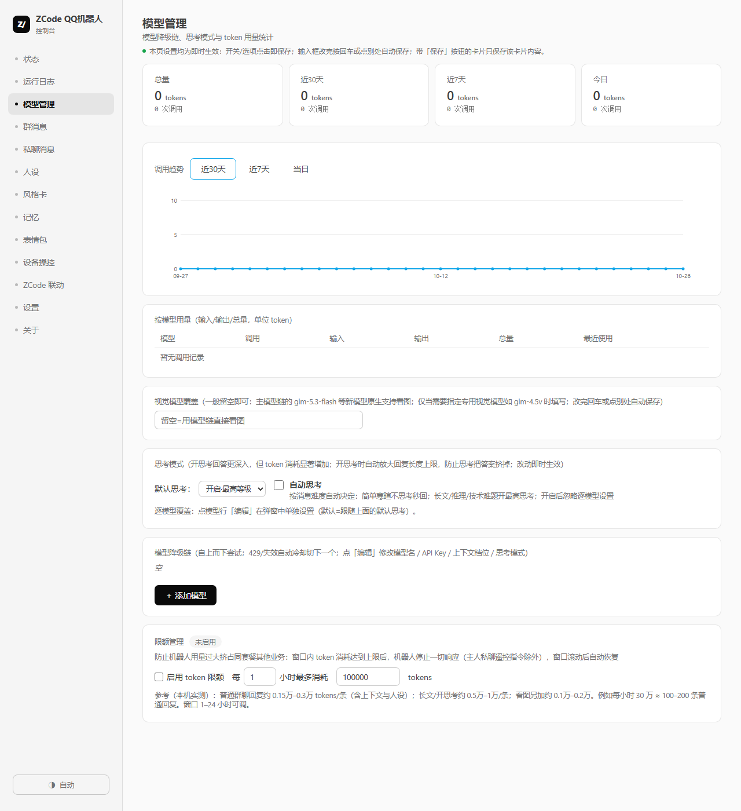
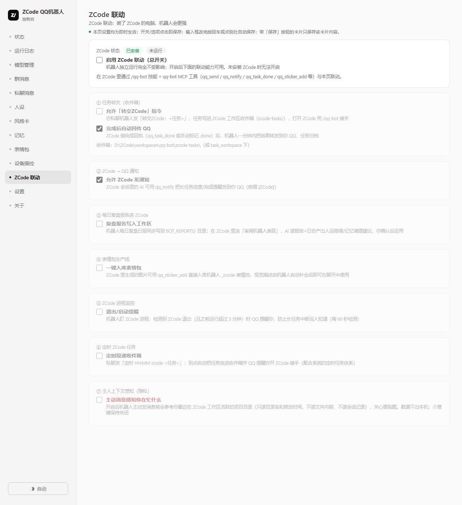

# ZCode QQ Bot

<p align="center">
  <a href="README.md">简体中文</a> · <a href="README_EN.md">English</a>
</p>

A QQ group-chat AI bot that lives on your Windows PC — powered by Zhipu GLM, packaged as a desktop app, and also shipped as a ZCode plugin.

Multi-persona chat, long-term memory, self-evolving speaking style, sticker library, image understanding & generation, task sandbox, device control, proactive messages, voice replies, Feishu bridge, and a plugin marketplace — plus deep integration with ZCode (works fully standalone without it).

Messages flow through [NapCat](https://napcat.net) (a QQNT protocol implementation); every behavior is controlled from a local admin console, and all data stays on your own machine.



## Features

### Chat & Personality
- **Multi-persona management**: built-in persona cards (create/rename/switch on the fly), plus a global baseline; per-contact personas — assign a dedicated persona by QQ number (private chat) or group ID
- **Self-evolving style**: the bot distills style observations from group chat and injects them into the matching persona — it sounds more natural over time
- **Long-term memory**: facts about people and group events are captured automatically; view/edit/add/remove anytime
- **Reply modes**: standard (@-only) / keyword / casual (probability-gated interjections with anti-interruption and interest gating), per-group overrides and pause
- **Stickers**: three libraries (persona / general / QQ favorites) — a vision model understands each sticker before sending, with rate limiting
- **AI-to-AI loop detection**: when another AI bot chats with yours at superhuman cadence, it asks "are you an AI?" in persona before deciding whether to keep talking
- **Abuse guard**: persona-injection defense, homework ghostwriting refusal, identity anchoring



### Capabilities
- **Image understanding**: images in messages go to a vision model
- **Image generation**: `draw: <desc>` or plain language ("draw me a…") — no rigid command format
- **Web search**: Zhipu search first, free Bing fallback; casual chat never triggers it
- **Voice replies** (marketplace plugin): replies become voice messages in persona; four providers — Edge-TTS (free, 9 Chinese voices), Zhipu GLM-TTS (paid, 3-second voice cloning), SiliconFlow, any OpenAI-compatible service; keyword / always / mixed strategies; auto-fallback to text
- **Task sandbox**: `task: …` hands work to an isolated subprocess (whitelisted commands, path limits, time budget)
- **Device control** (high-risk, opt-in): after a 6-digit dynamic code, the owner commands the PC in plain language — find/read/send files, launch apps (critical processes can never be touched); protected directories are unreachable; results go to private chat only
- **Proactive messages**: independent switches for groups/private, with probability, rate, per-group overrides and quiet hours
- **Scheduled tasks**: `schedule HH:MM <task>` runs in the sandbox and reports back
- **Bilibili browsing** (marketplace plugin): the bot browses videos by persona interests — injects what it watched into chat, shares favorites in its own voice (per-channel caps configurable), auto-detects BV links in messages
- **Chat-log import** (marketplace plugins for QQ/WeChat): import chat history into an isolated store, then have the bot digest it into persona drafts and memory candidates — via merged-forward messages, files, or one-click tool export
- **Feishu bridge** (marketplace plugin): two-way relay between QQ groups and Feishu groups, no public server needed

### Models & Cost
- **Multi-provider keys**: Zhipu / DeepSeek / Kimi / OpenAI / Grok / Gemini / custom OpenAI-compatible endpoints
- **Fallback chain**: per-entry key/context/output/thinking config; 429, expired plans and quota exhaustion trigger tiered cooldown and failover
- **Outbound proxy** for overseas providers (HTTP CONNECT, private addresses blocked)
- **Token quota & usage stats**: rolling-window limit; totals / 30-day / today cards, per-model breakdown, trend charts

### Stability & Ops
- **NapCat liveness watchdog**: detects "TCP alive but silent" connections, reconnects first, then restarts or alerts per settings
- **Daily auto-backup + one-click restore**: 15 item groups, retention by days and copies; secrets deliberately excluded
- **Log rotation + live log viewer**: four sources aggregated, one-click diagnostic bundle
- **Cache manager**: per-category sizes and manual cleanup (installers/assets/images) with recycle-bin safety
- **Single-file desktop experience**: first-run wizard, single-instance lock, out-of-the-box access token, in-app auto-update



## Plugin Marketplace

Features are not hard-coded — **plugins are first-class citizens**. Install, enable and update everything from the Plugins page with zero app changes:

| Plugin | What it does |
|---|---|
| Voice Reply | Make the bot speak (multiple TTS providers, see above) |
| Bilibili Browsing | Persona-driven video browsing, sharing, link cards |
| QQ Chat Import | Chat logs → persona & memory (merged-forward / file / qq-cli export) |
| WeChat Chat Import | WeChat variant (wechat-cli export + file import) |
| Feishu Bridge | Two-way QQ group ↔ Feishu group relay |
| Daily Quote | One "hitokoto" per day into context |
| Humanizer ZH | Less AI-flavored Chinese: concrete over abstract, uneven rhythm |
| Group Check-in | Send "签到" in group to check in; daily & all-time boards (third-party demo plugin) |

**Write your own**: one zip (plugin.py + manifest.json + optional page.js) unlocks the full capability surface — message hooks, sending (text/image/voice), scheduled jobs, context injection, declarative settings, private storage, custom endpoints, bundled settings pages. Install/enable/update all go through the plugin channel — **no app changes needed** (much like a Minecraft server core and its plugins). Publish your plugin to the marketplace for everyone. See [PLUGINS.md](./PLUGINS.md).

## ZCode Integration

Three roles first:

```
┌──────────────────────────────────────────────────────────┐
│ ZCode (AI coding assistant, GUI)                          │
│   └─ the AI in a session gets, via the qq-bot plugin:     │
│        • /qq-bot skill   • qq-bot MCP server (12 tools)   │
└──────────────┬───────────────────────────────────────────┘
               │ loopback HTTP / filesystem inbox
┌──────────────▼───────────────────────────────────────────┐
│ ZCode QQ Bot (this project, standalone desktop app)       │
│   console UI + daemon (pipeline) + agent (brain) + sandbox│
└──────────────┬───────────────────────────────────────────┘
               │ OneBot 11 over WebSocket
┌──────────────▼───────────────────────────────────────────┐
│ NapCat (injected into QQNT) ──→ QQ messaging              │
└──────────────────────────────────────────────────────────┘
```

**The bot runs fully standalone without ZCode**; with ZCode installed and the master switch on:

1. **MCP server (12 tools)** — the AI in ZCode sessions can drive the bot directly: status, send, memory, personas, test injection, and more
2. **Task inbox** — send `forward to ZCode: <task>` in QQ private chat → ZCode picks it up → result back to your QQ within a minute
3. **Daily review reports** — nightly reports land in the ZCode workspace so ZCode can regularly "coach" the bot
4. **ZCode process watch** — QQ alert when ZCode exits so long tasks never die silently
5. **Scheduled ZCode tasks**, **owner context awareness** (privacy-sensitive, off by default), **GUI operation relay** (fine-grained UI work delegated to ZCode's computer-use)



## Architecture

```
qq_app.py         desktop shell (pywebview window + tray + single-instance + self-heal)
  ├─ qq_admin_ui.py    admin console :39765 (pages + all config APIs, loopback only, token auth)
  ├─ qq_daemon.py      pipeline :39763 (OneBot WS client, trigger gating, send queue, liveness)
  ├─ qq_bot_agent.py   brain :39764 (model chain, persona/memory/safety, device control, review)
  ├─ qq_tts.py         TTS engine (Edge/Zhipu/SiliconFlow/custom OpenAI-compatible)
  ├─ qq_chatimport.py  chat-log import engine (parsing/isolated store/digestion)
  ├─ qq_lark.py        Feishu bridge engine
  ├─ qq_plugins.py     plugin host (hook routing/hot reload/private storage/custom endpoints)
  ├─ qq_task_worker.py task sandbox subprocess
  └─ qq_mcp_server.py  MCP server for the ZCode plugin (stdio)
qq_services.py    component lifecycle (idempotent start/stop, NapCat config, zip installer, autostart)
qq_common.py      paths/config/provider registry/timezone (data dir ~/.zcode-qq-bot, QQBOT_DATA_DIR overrides)
```

All data (keys, personas, memory, whitelists, logs, backups) stays in `~/.zcode-qq-bot/` on your machine.

## Install & Quick Start

### Option A: Download the release (recommended)

1. Grab `ZCodeQQBot-vX.Y.Z-win-x64.zip` from [Releases](../../releases) and extract
2. Run `ZCodeQQBot/ZCodeQQBot.exe` (data lives in your user directory regardless of exe location)
3. Follow the **first-run wizard**: bot QQ number + your QQ number → save
4. Add a Zhipu key in Settings → API Keys ([open.bigmodel.cn](https://open.bigmodel.cn))
5. Back on Status, hit "Start bot" → the NapCat login page opens, scan with the bot's QQ
   - If asked for a "login token": the NapCat token card shows it with one-click copy, or use "Open login page (token-free)"

### Option B: Run from source

```
git clone https://github.com/Pigeon2333/zcode-qq-bot.git
pip install pywebview pystray pillow edge-tts
cd plugins/qq-bot/scripts
python qq_app.py
```

### Requirements

- Windows 10/11 x64
- Regular QQ (QQNT) installed
- **NapCat Shell**: `launcher-user.bat` must exist under the QQNT directory; one-click install from official zip in Settings → Runtime
- A Zhipu API key ([open.bigmodel.cn](https://open.bigmodel.cn))

## User Guide

### Console pages

| Page | Contents |
|---|---|
| Status | component switches, first-run wizard, start/pause, watchdog, traffic stats |
| Logs | daemon/agent/boot/NapCat aggregated live |
| Models | fallback chain, thinking mode, usage stats, token quota |
| Groups / Private | reply modes, whitelist, proactive messages, per-group overrides |
| Persona / Style / Memory | persona cards, style evolution, long-term memory CRUD |
| Stickers | three libraries, upload, vision descriptions |
| Device Control | enable switch, dynamic code, action execution, protected dirs |
| ZCode | master switch + seven independent integrations |
| Plugins | my plugins (toggle/settings) + marketplace (category filter) |
| Settings | identity, runtime, API keys, chat behavior, automation (backup/cache), app behavior |
| About | project info, contributors, in-app update |

### From QQ (owner)

- **Remote control**: send "帮助" for the full command list
- **Image generation**: plain language (`draw: desc`, "draw me a…")
- **Voice**: with the plugin installed, say 念一下 / "send me a voice message" — or anything she deems voice-worthy
- **Device control**: express intent → bot asks for the 6-digit code → read it from the console → command in plain language; results to private chat only
- **Scheduled tasks**: `定时 22:00 <task>` / list / delete
- **Task sandbox**: `任务：<desc>`
- **Import chat logs**: merged-forward messages + "导入" → straight into the store, then "learn as persona" on the plugin page

### What group members see

@-replies with persona flavor, image conversations, stickers, being remembered, (if enabled) proactive chatter, and plugin features (check-in / video shares / voice). Homework ghostwriting gets refused in persona.

## Operations

### Daily start/stop

- Status page: Start bot (idempotent) / Stop brain & pipeline (keeps login) / Full stop (incl. NapCat)
- Tray icon reopens the window; close behavior is configurable
- Autostart with Windows and auto-start-on-launch are both optional

### Logs & troubleshooting

- `~/.zcode-qq-bot/logs/`: daemon.log / agent.log / ui.log (auto-rotated past 20MB)
- Console log page aggregates four sources, 3s refresh, one-click diagnostics export
- Common patterns:
  - Online but silent → NapCat push half-dead; the watchdog recovers automatically
  - `AGENT_MODEL_FAIL` bursts → 429 = overload (auto cooldown), 1308 = 5h window, 1314 = expired plan
  - "Persona/memory lost" → restore from backup in one click

### Backup & restore

Daily auto-backup (directory/retention configurable); restore picks a snapshot with a red confirmation. Take a manual snapshot before big changes.

### Models & cost

- Chain order = fallback order; entries bind their own key, context size and max output
- Free/promotional quota is consumed first automatically
- Cost-sensitive: enable "lean context" (30–45% savings) and "peak saving mode", set a token quota

### Updates

In-app auto-update (About page): download → SHA256 verify → replace program dir → auto-restart, **never touching the data directory**. Point the update source at your own fork if you like; private repos need a fine-grained PAT.

Plugin updates are independent of app releases — plugin changes ship through the plugin channel; one click and they're in.

## Security Model & Risk Notice

### Built-in defenses

- Console binds to 127.0.0.1 only, with token auth on every API
- Device control: owner-only QQ + rotating 6-digit code + time-boxed window + protected dirs + private-chat results + critical processes untouchable
- Sandbox: whitelisted commands, path limits, time budget
- Installer: filename whitelist + containment checks (zip-slip) + auto-backup
- Custom provider endpoints block private/loopback addresses (SSRF)
- Prompt layer: task-abuse interception, injection refusal, identity anchoring
- Secrets stay in the local data dir — never in the repo, never in backups

### Risk notice (please read)

- **Device control really operates your PC**: don't enable on shared machines; add protected dirs; turn off when unused
- **API key risk**: keys sit in plaintext in the local data dir. Leaked key = spent quota; never commit `~/.zcode-qq-bot/` or sync it to cloud drives
- **QQ account risk**: any unofficial protocol implementation (NapCat included) can theoretically trigger risk control or bans — assess yourself, prefer a spare account
- **Generated content**: AI output doesn't represent the author; safety rules exist but can't guarantee 100% compliance
- Provided "as is"; the author is not liable for any damage

## FAQ

**Q: The bot went totally silent but the console shows online?**
A: Likely NapCat push half-dead. The watchdog recovers automatically; otherwise Full stop → Start bot.

**Q: "agent failed to start" at launch?**
A: Usually just a missing API key — the agent idles online waiting; fill the key and it takes effect immediately, no restart.

**Q: Where do I find the NapCat "login token / WebUI token"?**
A: No need to copy it by hand — the token card on the Status page reads and shows it, and "Open login page (token-free)" goes straight in. NapCat rotates the token after a successful QR login; hit Refresh on the card then.

**Q: Can I import QQ's built-in chat export (.bak)?**
A: No — it's an encrypted container keyed to your account. Use merged-forward + "导入", or the file-import path the plugin page guides you through.

**Q: Migrating to a new PC?**
A: Copy the whole `~/.zcode-qq-bot/` directory (includes secrets — keep it safe).

**Q: Keep the bot quiet in one group?**
A: Set that group to "paused" on the Groups page, or remove it from the whitelist (with confirmation).

## Contributing

- **Issues**: bug reports and feature ideas
- **PRs**: provider adapters, sticker sources, plugin ecosystem, UI polish, tests, docs
- **Write a plugin**: see [PLUGINS.md](./PLUGINS.md); open an issue to get yours listed on the marketplace
- Convention: changes pass syntax checks and page-render self-tests; **persona copy goes in persona cards, never the base prompt**

## Author & Credits

**从不咕咕的鸽纸 (Pigeon)** · [Bilibili](https://space.bilibili.com/280664902) · [GitHub](https://github.com/Pigeon2333) · ed@sodayo.net

- Brain: [Zhipu GLM](https://open.bigmodel.cn) models
- Protocol: [NapCat](https://napcat.net) (OneBot 11)
- Ecosystem: [ZCode](https://zcode.ai) and its plugin system
- Thanks to the friends in the test groups who chatted with her and made her better

## License

Licensed under [PolyForm Noncommercial 1.0.0](./LICENSE):
personal study, research, modification and redistribution (including modified versions) are **allowed**; any commercial use is **prohibited**. Keep the license and copyright notice when redistributing.
