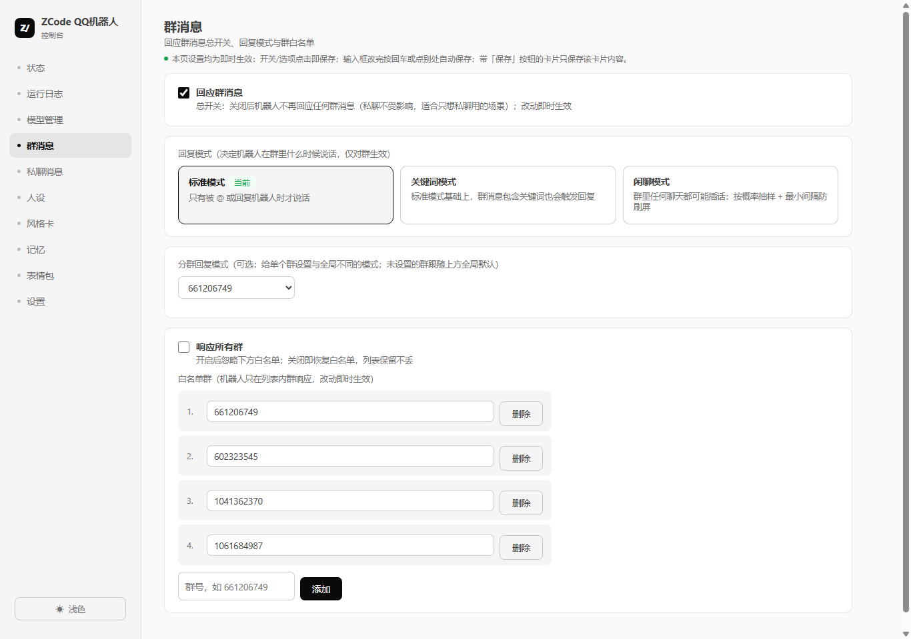
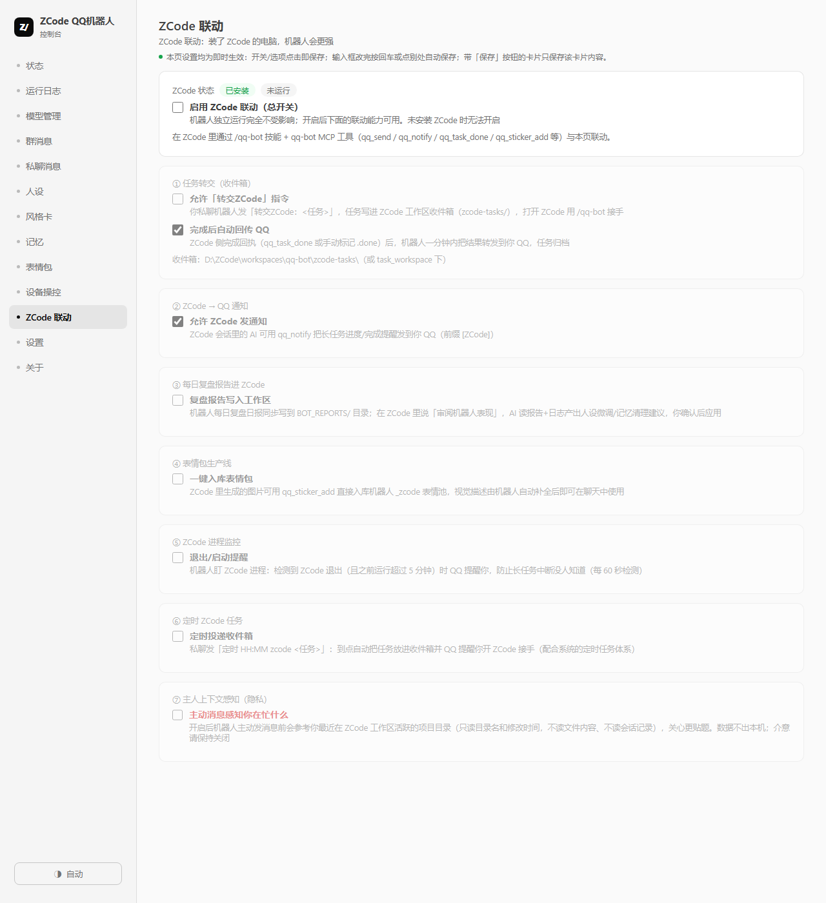
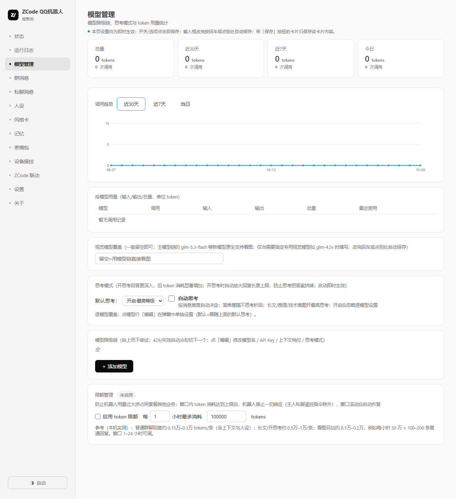

# ZCode QQ Bot

<p align="center">
  <a href="README.md">简体中文</a> · <a href="README_EN.md">English</a>
</p>

A QQ group-chat AI bot that runs on your Windows PC. Zhipu GLM under the hood, shipped as a desktop app, also installable as a ZCode plugin.

It differs from the usual "wrap an API and go" QQ bots in a few ways:

- **More than chat**. Image understanding, image generation, web search, voice messages, controlling your PC, running code tasks — all built in, not a pile of bolted-on scripts. Device control uses a rotating 6-digit code, one per session.
- **Actually remembers**. Things mentioned in passing become long-term memory and resurface naturally later. Her speaking style keeps adapting to your group over time.
- **Plugins own the features**. Voice replies, Bilibili browsing, chat-log import — all marketplace plugins. Install, skip, or update them without touching the app. Write your own and publish it; no need to wait on app releases.
- **Everything stays local**. Personas, memory, API keys, chat data — all in `~/.zcode-qq-bot/`. No cloud service, no account system. Copy the folder, and the migration is done.

Messaging runs through [NapCat](https://napcat.net) (a QQNT protocol implementation). Everything is controlled from a local admin console.



## Contents

- [Features](#features)
- [Plugin marketplace](#plugin-marketplace)
- [Architecture](#architecture)
- [Install](#install)
- [Daily use](#daily-use)
- [Operations](#operations)
- [Security & risks](#security--risks)
- [FAQ](#faq)
- [Contributing](#contributing)

---

## Features

### Chat

Multi-persona is the distinctive part: build several persona cards and switch instantly, or assign per contact — one persona for a friend's private chat, another for a specific group, everyone else on the default. Switching takes effect immediately, no restart.

Her speaking style grows on its own. Periodically she distills "what's the vibe in this group lately" into one or two observations and writes them into the matching persona, so the longer she's around, the more she sounds like a regular rather than a factory default.

Memory splits into two kinds: facts about a specific person ("he mentioned an interview last week") and group events ("we agreed to play on Friday"). Both are captured automatically and editable in the console. She brings them up only when relevant — she doesn't rifle through old notes every message.

Three reply modes: standard (talks only when @'d or replied to), keyword, and casual (probabilistic interjections, gated by "is this worth joining" and "are they actually talking to me"). Each group can have its own mode. If another AI bot in the group starts a superhuman back-and-forth with her, she asks "are you an AI?" like a person would, and wraps it up naturally once confirmed.

Stickers come from three libraries: persona-specific, shared, and imported from QQ favorites. A vision model looks at each sticker first and judges whether it fits the moment — so misfires are rare. Rate limits keep her from spamming.

### Capabilities

Image understanding: images in messages go straight to a vision model — screenshots, memes, photos all work. Images inside merged-forward chat records are treated as part of the text, not fetched for vision; when a message carries more images than one call can attach (cap 4, or a fetch failure), only the ones that made it are attached and the model is told how many are missing. You can give vision its own model instead of sharing the main one.

Image generation: "draw a xxx" or something looser like "make me an avatar" both work. No required command prefix. Sometimes the model understands but the system misses it; she'll emit an internal marker herself to retrigger.

Web search: real-time questions (news, releases, prices) trigger it automatically. Zhipu's search add-on comes first; if you don't have it, a free Bing fallback kicks in. Casual chat never triggers search, so it never costs you anything.

MCP tool bridge: the bot itself is an MCP client (managed on the "MCP Services" page). Enabled services inject their tool catalog into her context; in chat you just state the need and she picks tools, chains steps, and reports back in her usual voice — only the master's messages can trigger calls, and everything defaults to off. All three transports work (stdio / http / SSE, with aliases like streamable_http normalized). Zero setup for ZCode users: services installed in ZCode are reused directly (http via the same instance, stdio spawned locally; ZCode doesn't need to be running). Without ZCode, add services in a dialog — form fields for timeout/headers/env/protocol version, or paste JSON: a single server, ZCode format, or a whole Claude Desktop `mcpServers` block (multiple at once).

Voice: she sends voice messages. Five voice sources — Edge-TTS is free with nine built-in Chinese voices; Zhipu GLM-TTS is paid but can clone a custom voice from three seconds of audio; GPT-SoVITS runs fully free on your own GPU with instant 3-second cloning and community fine-tuned model import (.ckpt+.pth, the highest fidelity, mutually exclusive with cloned voices); plus SiliconFlow and any OpenAI-compatible service. You set when she uses voice: trigger words, always, or keywords-mandatory-with-probability. If synthesis fails she falls back to text, so nothing gets lost.

Task sandbox: send "task: write a scraper for xxx" and it goes to an isolated subprocess with whitelisted commands and a time budget. Results come back automatically.

Device control: the most powerful and most dangerous feature. Say "find that report on my PC" in private chat and she'll ask for a 6-digit dynamic code (shown live in the console, changes each use). Authorized, you command in plain language — find files, read them, send them, open apps. Critical system processes are untouchable, protected directories are unreachable, and all results go to private chat only. Whether a code is required at all is governed by one switch, "Dangerous actions need an auth code" (device-control page; shared by device control and dangerous tool actions): it follows your previous setting by default; turn it off and the owner commands directly — owner-only still applies, and the red confirmation before dangerous actions in the console stays. Turn it off when you don't need it.

Proactive messages: let her start conversations herself, controlled separately for groups and private chat, with probability caps, rate limits and quiet hours. She won't ping you at 3am unless you ask for it.

Scheduled tasks: "定时 22:00 write the weekly report" runs on time and reports back.

Tool loop: enable it on the "工具循环（实验性）" (tool loop, experimental) card in the console; off by default, and it only acts on the master's messages. Once on, when you ask her to do something she really runs it from a built-in tool list and reports back with the result — and says so plainly when she can't. The list currently has: web search, tagging a message with a sticker reaction, posting a message to a group on your behalf, image generation, scheduled tasks (add and list), and the eight device-control actions (only there when device control is on); the external tools of enabled MCP services sit on the same list (only there when the MCP master switch is on) and go through the same flow as built-in tools — with the tool loop off, external tools keep working exactly as before. Posting to a group only reaches groups in your whitelist: digits are matched as an exact group ID; a group name is matched by full name first, then by containment; if several groups match she won't post and asks you for the ID. With "发消息这类动作先复述、等确认再执行" (describe action-type steps first and wait for confirmation) on, action-type tools restate what they're about to do and run only after you reply "确认" (confirm); no reply within two minutes counts as a no. Dangerous actions like opening or closing programs still require the auth code.

Natural-language commands: another switch on the same card (off by default), owner private chat only. Until now the master had to type exact commands; with it on, everyday phrasing works too — exact commands still hit directly as before, and only when one doesn't does she spend one "judge"-purpose model call to recognize which command you mean and hand it to the existing command handler, so the reply is word-for-word what a typed command returns. Lookups (status, usage, help, lists, logs) plus "安静" (quiet time) and "继续" (back to chatting) run directly; the nine settings-changing commands (add/delete scheduled tasks, add/remove groups, toggle image understanding / web search / anti-abuse, pause, resume, switch persona, hand off to ZCode) carry extra guardrails — a higher confidence bar, and group IDs / entry numbers / persona names / task text must come from your own words (she won't invent them), with a confirm-first step when the confirmation switch above is on. If the parameters don't check out she tells you what didn't and how to send it properly, instead of pretending. Before turning it on, give the "judge" purpose a fast model under Models & cost → "choose models by purpose"; otherwise every private chat waits one extra main-model call.

Group admin: the "群管理" console page covers per-group management (scheduled whole-group mute with cross-midnight windows, keyword auto-recall, keyword recall+mute, group announcement view/edit/publish, quick actions) and batch management (pick multiple groups, blast one announcement everywhere, apply settings in bulk). The bot must be a group admin; dangerous actions all get confirm dialogs.

Conversational group admin: with the switch on, no console needed — just tell her "post an announcement in group X", "mute 张三 for 10 minutes" (say the name, she resolves the card), "recall 张三's last two messages", "mute everyone". Works in private and group chat, across groups. Four layers of guardrails: off by default, capability teaching is injected only into the owner's messages (other members never even know it exists), hard owner verification before execution, protocol markers never leak. Members joking "mute me" get a persona-flavored deflection — she never pretends to have done it, and failures come back as human words in persona voice.

Bilibili browsing (plugin): she browses with her own registered Bilibili account, driven by persona interests. What she watches becomes conversational material; videos she genuinely likes get shared to you proactively — Bilibili DM or QQ, with per-channel per-round caps. BV links in chat automatically pull in video info.

Bilibili subscription push (plugin): subscribe to UP masters; new videos, image-text posts, and live-stream starts get forwarded to your chosen groups or private chats. Push history is tracked per target with success/fail badges; anything can be re-pushed to any group or private chat in one click.

AI cover singing (plugin): quote a voice message and say "翻唱" — she sings the whole thing in the chosen voice (so-vits-svc local GPU inference, zero API cost). One-click engine deploy; community singing model packs import from the plugin page.

Chat-log import (plugins for QQ and WeChat): merged-forward a chat history to her with "导入" and it lands in an isolated store; hit "learn as persona" on the plugin page to digest it. File import and one-click tool export also work.

Feishu bridge (plugin): two-way relay between QQ groups and Feishu groups, no public server needed.

### ZCode Integration

The bot runs fully without [ZCode](https://zcode.ai) (an AI coding assistant). Install it and flip the integration master switch to unlock a set of "two AIs working together" abilities:

- **Task inbox**: say "转交ZCode: help me look at this error" in QQ private chat — the task lands in ZCode's inbox and results flow back to your QQ within a minute
- **Reverse MCP control**: the AI inside ZCode sessions drives the bot directly — status, sending, memory, persona switching — through this project's MCP server (12 tools), not simulated clicks
- **Daily review**: her nightly ops report lands in the ZCode workspace, so ZCode can review her performance and suggest persona tweaks
- **ZCode process monitor**: if the ZCode process exits, the bot pings you on QQ — long tasks shouldn't die silently
- **Scheduled ZCode tasks** / **master context awareness** (privacy-sensitive, off by default) / **GUI handoff**: fine-grained GUI work (clicking buttons, filling forms) gets delegated to ZCode's computer-use capability

This is the mirror image of the MCP tool bridge above: **the bridge lets the bot use services installed in ZCode; integration lets ZCode manage the bot** — enable both and they're wired both ways.



### Models & cost

The model chain is what keeps her stable. Configure multiple models (Zhipu, DeepSeek, Kimi, OpenAI, Grok, Gemini, or any OpenAI-compatible endpoint) in order — if one fails the next takes over, 429s trigger a cooldown before returning, expired plans get skipped. Each entry binds its own API key; overseas providers can use a dedicated outbound proxy.

Four kinds of work (replies, whether-to-reply gating, small judgements, memory distillation) can each be pinned to a specific chain entry in Console → Settings → Models & cost ("choose models by purpose"); everything follows the chain by default, and leaving it untouched keeps today's behavior. A pinned model still falls back to the chain when it fails or is cooling down, and a console-pinned "use now" model keeps top priority. Each purpose carries its own retry budget (gating and judgements default to 30 s, replies and memory to 200 s, adjustable 5–600 s) — the budget caps how long one call keeps hopping to the next model when servers misbehave; when it runs out that call is abandoned (a reply is skipped for that message, a gate or judgement falls back to its default) and the next message is served as usual.

Usage stats live on the model page: totals, last 30 days, today, broken down by model, with trend charts. Set a rolling token quota and she stops when it's hit. To save money, enable lean context (30–45% fewer tokens) and peak-hour saving mode (thinking off, flagship skipped automatically).

Zhipu's free quota (like new-user grants) is consumed first automatically by entries on the same key, with graceful fallback when it runs out. No manual juggling.



### Operations

The watchdog solves "shows online but receives nothing" — NapCat sometimes ends up with a TCP connection that no longer pushes events. Every 45 seconds it probes with a real action; on failure it reconnects first, and only restarts components if that fails (with a 15-minute cooldown so it never loops).

Nightly auto-backup covers 15 data groups (personas, memory, config…) locally, with retention by days and copies. Broke a persona? One click to restore from this morning's snapshot. Secret files are deliberately excluded from backups, so a leaked backup doesn't leak keys.

Cache management lives in settings: installer caches, material caches and image temp files listed by size, cleaned manually. Deleted items go to the recycle bin, not the void.

In-app updates: check on the About page, download, SHA256 verified, program directory replaced. `~/.zcode-qq-bot/` stays untouched.

## Plugin marketplace

Install, pause and update plugins from the console's Plugins page. No app changes involved.

| Plugin | What it does |
|---|---|
| Voice Reply | The voice feature described above |
| Bilibili Browsing | The Bilibili features described above |
| QQ Chat Import | Chat logs → persona (merged-forward / file / qq-cli export) |
| WeChat Chat Import | WeChat variant |
| Feishu Bridge | QQ group ↔ Feishu group relay |
| Daily Quote | One hitokoto per day into context |
| Humanizer ZH | Less AI-flavored Chinese |
| Group Check-in | Send 签到 in group to check in; daily and all-time boards (third-party demo plugin) |

Writing your own is fair game, and doesn't require waiting on my app releases. One zip (plugin.py + manifest.json, plus page.js if it needs a settings page) gets you the full API surface: message hooks, sending text/images/voice, scheduled jobs, context injection, declarative settings, private storage, custom HTTP endpoints. Install and it works; updates flow through the plugin channel independently — similar to how a Minecraft server core relates to its plugins. Plugin settings pages (page.js) run in an isolated sandbox iframe: they can use the host-provided `api`/`esc`/`toast`/`dlgConfirm`/`plPage`/`head` helpers but cannot touch the console's token or globals, and `api()` only reaches a small path whitelist. To share yours, open an issue and I'll list it on the marketplace. Docs in [PLUGINS.md](./PLUGINS.md).

## Architecture

```
qq_app.py         desktop shell (pywebview window + tray + single-instance + self-heal)
  ├─ qq_admin_ui.py    admin console :39765 (pages + all config APIs, loopback only, token auth)
  ├─ qq_daemon.py      pipeline :39763 (OneBot WS client, trigger gating, send queue, liveness)
  ├─ qq_bot_agent.py   brain :39764 (model chain, persona/memory/safety, device control, review; messages are handled one by one by default, adjustable to per-chat parallelism)
  ├─ qq_tts.py         TTS engine (Edge/Zhipu/SiliconFlow/custom OpenAI-compatible)
  ├─ qq_chatimport.py  chat-log import engine (parsing/isolated store/digestion)
  ├─ qq_lark.py        Feishu bridge engine
  ├─ qq_plugins.py     plugin host (hook routing/hot reload/private storage/custom endpoints)
  ├─ qq_task_worker.py task sandbox subprocess
  ├─ qq_mcp.py         MCP client bridge (stdio/http/sse; reuses services installed in ZCode)
  └─ qq_mcp_server.py  MCP server for the ZCode plugin (stdio)
qq_services.py    component lifecycle (idempotent start/stop, NapCat config, zip installer, autostart)
qq_common.py      paths/config/provider registry/timezone (data dir ~/.zcode-qq-bot, QQBOT_DATA_DIR overrides)
```

## Install

### Release build (recommended)

1. Grab the zip from [Releases](../../releases) and extract
2. Run `ZCodeQQBot/ZCodeQQBot.exe`
3. Fill in the bot's QQ number and yours in the first-run wizard
4. Add a Zhipu API key in Settings ([open.bigmodel.cn](https://open.bigmodel.cn) — free quota on signup)
5. Hit "Start bot" on Status, scan with the bot's QQ on the NapCat page that opens

If the login page asks for a "login token", don't panic: the token card on the Status page shows it with one-click copy, or just hit "Open login page (token-free)".

### From source

```
git clone https://github.com/Pigeon2333/zcode-qq-bot.git
pip install pywebview pystray pillow edge-tts
cd plugins/qq-bot/scripts
python qq_app.py
```

### Requirements

Windows 10/11 x64; QQNT installed; NapCat Shell (one-click install from the console); a Zhipu API key.

## Daily use

Send "帮助" in private chat for the full command list. The common ones: image gen by plain language; device control starts with intent then the code; scheduled tasks look like "定时 22:00 do the thing", with "定时列表" to list them and "删定时 编号" to delete one; tell her "安静" for quiet time; say "暂停" to stop all auto-replies — messages that piled up while paused are skipped by default after resuming (the "恢复后不回暂停期间的消息" toggle on the console Status page governs this); merged-forward chat logs plus "导入" feed her for learning.

Group members get: @-replies with persona flavor, showing her images, being remembered, (if you enabled it) proactive chatter, and plugin features like check-in and video shares. Ask her to do your homework and she'll refuse in persona — she's not a tool.

## Operations

Logs live in `~/.zcode-qq-bot/logs/`; the console aggregates four sources live and can export a diagnostics bundle.

Reading the signs:

- Online but totally silent — NapCat push is half-dead; the watchdog recovers on its own, or full-stop then start if you're impatient
- Bursts of `AGENT_MODEL_FAIL` — check the code: 429 is overload (chain auto-switches), 1308 is Zhipu's 5-hour window, 1314 is an expired plan (swap or delete that entry)
- Persona broken or lost — restore from backup, pick this morning's snapshot

Upgrades go through in-app update and never touch the data directory. Plugin updates are independent of app versions — hit update in the marketplace and you're done.

## Security & risks

The console binds to 127.0.0.1 only; every API sits behind token auth. Device control has three layers: owner-only QQ, a rotating one-time code, and hard walls around critical processes and protected directories.

A few things to keep in mind yourself:

- **Device control really operates your PC.** Don't enable it on shared machines. Add protected dirs as needed, and turn it off when you're not using it.
- **API keys sit in plaintext locally.** That's normal for desktop apps, but it means anyone with your `~/.zcode-qq-bot/` folder can spend your quota. Never commit it, never put it in a synced drive.
- **NapCat is an unofficial protocol implementation**, so Tencent's risk control is a theoretical possibility. Weigh it yourself; a spare account is the safe call. The settings page has a "risk-control mitigation" section with three toggles: image-fetch rate limiting (per-minute/per-day windows; repeated images serve from cache without counting), proactive-message throttling (night silence + halved probability + doubled intervals), and humanized send pacing (random reaction delay on the first reply).
- **Everything she says is AI-generated.** Plenty of safety rules, but no guarantees — keep an eye on group settings.

## FAQ

**Bot shows online but never replies?**
Most likely NapCat push is half-dead. The watchdog recovers on its own by default; full-stop then start if you're in a hurry.

**"agent failed to start" at launch?**
Nine times out of ten the API key isn't filled in yet. It takes effect immediately once saved — no restart.

**Where's the NapCat "login token"?**
The token card on the Status page, one-click copy. NapCat rotates it after a successful QR login; hit Refresh on the card when that happens.

**Can I import QQ's built-in chat export (.bak)?**
No. That file is encrypted with account-held keys that third parties can't get. Use merged-forward + "导入", or export to text per the plugin page's guidance.

**Migrating to a new PC?**
Copy the whole `~/.zcode-qq-bot/` folder (secrets inside — keep it safe).

**Keep the bot quiet in one group?**
Set that group to "paused" on the Groups page, or remove it from the whitelist (with confirmation).

## Contributing

Issues for bugs and ideas are welcome. PR directions: provider adapters, sticker sources, the plugin ecosystem, UI, tests, docs. To write a plugin see [PLUGINS.md](./PLUGINS.md) — open an issue to get it listed on the marketplace.

One convention: persona copy goes in persona cards, never the base prompt. That keeps other users' personas unpolluted and plugin capability ownership clean.

## Author

从不咕咕的鸽纸 (Pigeon) · [Bilibili](https://space.bilibili.com/280664902) · [GitHub](https://github.com/Pigeon2333) · ed@sodayo.net

Brain: [Zhipu GLM](https://open.bigmodel.cn). Protocol: [NapCat](https://napcat.net). Ecosystem: [ZCode](https://zcode.ai). Thanks to the friends in the test groups who chatted with her and made her better.

## License

[PolyForm Noncommercial 1.0.0](./LICENSE): personal study, research, modification and redistribution are fine; commercial use is not. Keep the license notice when redistributing.
